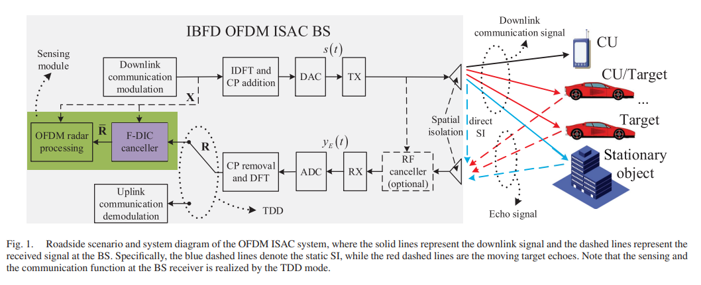
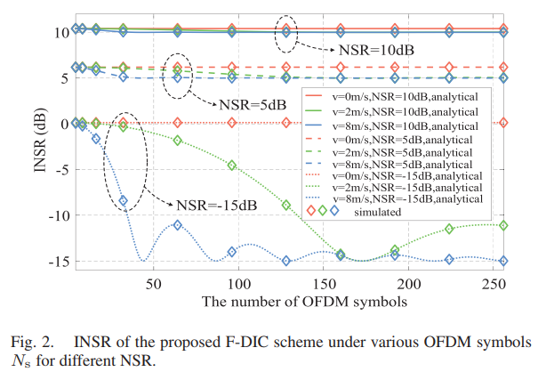
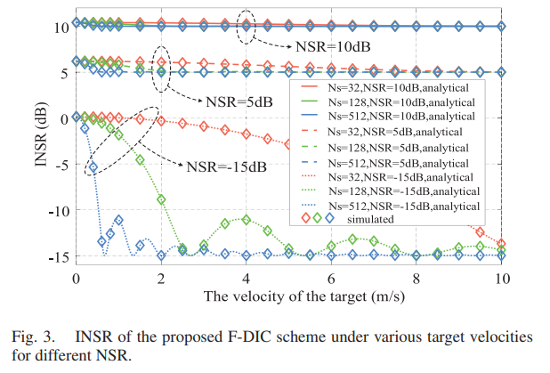
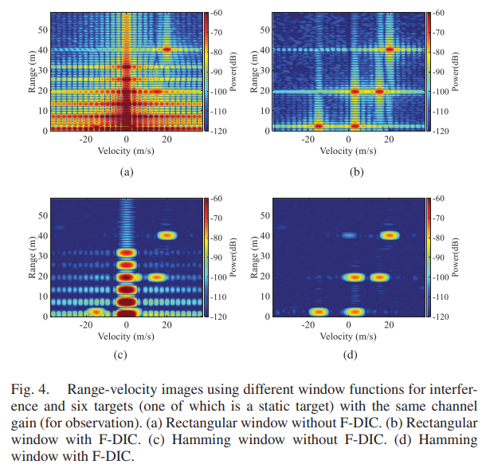
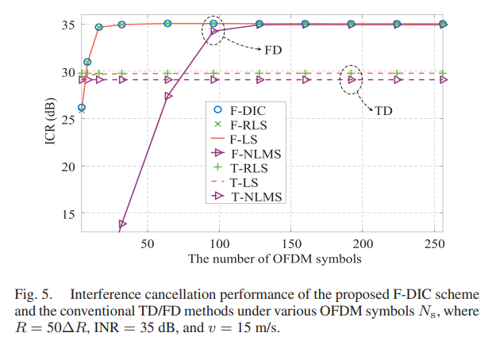
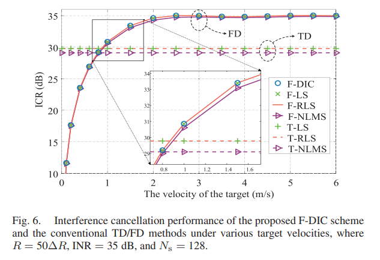
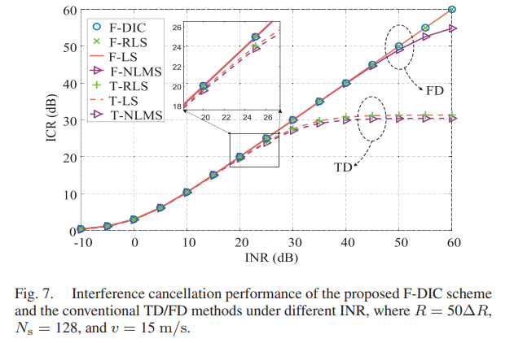
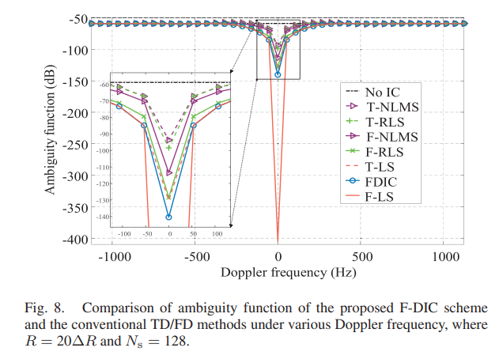
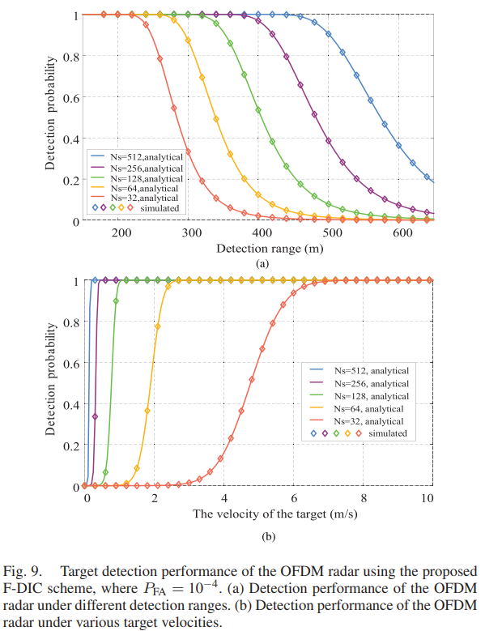

# ISAC+ anti-interference - Frequency domain differential interference cancellation technology makes full duplex OFDM ISAC system more efficient[with MATLAB + Python code]

Personal Blog: https://www.cnblogs.com/EWFrontier  
✿ Breakthrough in Frequency-Domain Differential Interference Cancellation (F-DIC) for Full Duplex OFDM ISAC Systems ✿ 1. Article Title: Frequency-Domain Differential Interference Cancellation Techniques for Full Duplex OFDM ISAC Systems  
2. Abstract: In recent years, Integrated Perception and Communication (ISAC) systems with In-Band Full Duplex (IBFD) have received widespread attention due to their ability to enhance spectral efficiency and reduce perception latency. However, in the IBFD mode, transmitted signals can cause severe interference at the receiving end. This paper proposes a low-complexity frequency-domain differential interference cancellation (F-DIC) scheme that does not require channel state information (CSI), utilizing the invariant characteristics of interference to cancel static interference and extract moving target echo signals. The residual interference of this method is evaluated, the interference cancellation ratio (ICR) is analyzed, and a closed-form expression for target detection probability based on the Naiman-Pearson (NP) criterion is derived. Simulation results show that the proposed F-DIC method has low computational complexity and performs comparably to traditional frequency-domain interference cancellation methods based on least squares (LS) and recursive least squares (RLS) algorithms.  
3. Introduction: With the development of emerging applications such as Industrial Internet of Things (IIoT) and Vehicular Networking (V2X), there is an increasing demand for high-quality wireless connectivity and high-performance perception capabilities. Integrated Perception and Communication (ISAC) technology based on orthogonal frequency division multiplexing (OFDM) waveforms has become a research hotspot for next-generation wireless networks, such as ultra-5G and 6G. To achieve high spectral efficiency and low perception latency, the In-Band Full Duplex (IBFD) mode of OFDM ISAC systems has attracted widespread attention, which can simultaneously transmit communication signals and receive environmental reflection signals.
However, the IBFD model can cause severe interference to the receiving end. The receiving end simultaneously receives three types of signals: direct self-interference (SI) from the transmitter, multipath interference reflected by environmental objects (echo interference), and target echoes from the target. Direct interference power is high, which may mask close-range and low-speed targets. Although multipath interference has a lower power, it can still cause target misjudgment. Therefore, interference cancellation at the receiving end is necessary to enhance perception capabilities.
Existing interference cancellation methods include spatial isolation, radio frequency domain cancellation, and digital domain cancellation (time, frequency, space), but they have shortcomings: time-domain methods are complex and cannot attenuate multipath interference beyond the maximum cancellation range; traditional frequency-domain methods rely on CSI and some algorithms have high complexity; spatial domain methods require high antenna deployment requirements for devices, which are not suitable for miniaturization and low power consumption. Based on this, this paper proposes a low-complexity F-DIC method without CSI to solve the core issues of static interference cancellation and mobile target echo extraction.
IV. Method Overview
Key Step 1
Frequency domain differential sequence calculation: On the same subcarrier, perform a differential operation on the received signal of consecutive OFDM symbols to initially separate static interference from moving target signals.
2  
Recursive Smoothing Process: Through a recursive formula, smooth the differential sequence to reduce the impact of noise and residual interference, thereby enhancing the effectiveness of signal extraction.
3  
Target Signal Estimation: Based on the smoothed sequence, estimate the initial value of the moving target echo signal and derive the subsequent symbol's target signal estimation values. Ultimately, output the useful signal after eliminating interference.
Advantages and Characteristics✧
No CSI: No need to pre-fetch channel state information, simplifying system deployment and signal processing processes.
✧  
Low complexity: Reuse existing processing modules of OFDM radar (such as FFT, element-level division), without the need for additional complex multiplication operations, significantly reducing computational burden compared to traditional LS/RLS algorithms.
✧
Compatibility strong: Suitable for small, low-power ISAC devices and inherently compatible with OFDM systems.
Conclusion: This paper proposes a low-complexity frequency domain differential interference cancellation (F-DIC) method for static interference issues in full-duplex OFDM ISAC systems based on the invariance property of interference. This method does not require channel state information, and through frequency domain differential and recursive smoothing operations, effectively cancels static interference and extracts moving target echo signals.
Performance analysis and simulation verification indicate that the Interference Cancellation Ratio (ICR) of the F-DIC method approaches the Static Interference Noise Ratio (INR) as the number of OFDM symbols increases, and the probability of target detection improves with an increase in symbols; under scenarios where moving targets move at speeds greater than 2m/s, its interference cancellation performance is comparable to that of traditional LS/RLS frequency domain methods, and its computational complexity is only about one-third of that of traditional methods.
This method successfully addresses the core issue of static interference masking moving targets, is suitable for ISAC scenarios in next-generation wireless networks, especially adaptable to small, low-power devices, providing an efficient solution for the engineering application of full-duplex ISAC systems.
★

## Images

<!-- PAYMENT_BLOCK -->

## Get this dataset

- Payment link (Stripe): [Buy now](https://buy.stripe.com/3cs8yP7sY87d0vu9AB)
- Payment QR code: 

<!-- /PAYMENT_BLOCK -->
